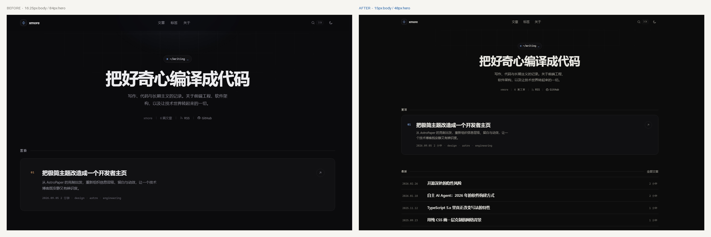

# xmore · 极简博客

> 一个用 Astro 承载、样式全部手写的极简开发者博客 —— 没有 UI 框架，没有 Tailwind，没有多余的一层。

[](https://github.com/xmore2025/New-post-xmore2025-astro/actions/workflows/deploy.yml)
[](./LICENSE)
[](https://astro.build)
[](https://nodejs.org)

**[🌐 在线预览](https://web2046.xmorexz.dpdns.org)** · **[📄 优化说明](./OPTIMIZATION.md)**


<details>
<summary>改版对照：字号整体降一档，层级靠留白而不是字号</summary>



</details>

---

## ✨ 特性

| | |
| --- | --- |
| **3 个依赖** | `astro` · `@astrojs/rss` · `@astrojs/sitemap`，仅此而已 |
| **零 UI 框架** | 无 React / Vue / Tailwind，样式是 1 份分层手写 CSS |
| **排版优先** | 4 级字阶 · 15px 正文 / 1.85 行高 · 约 40 汉字行宽 · 发丝分隔线 |
| **安静的视觉** | 单一强调色、暖纸底、无阴影卡片、克制到只剩"确认感"的动效 |
| **明暗主题** | 跟随系统、可手动切换、`localStorage` 记忆、首屏无闪烁、地址栏颜色同步 |
| **页面切换** | 原生跨文档 View Transition 淡入 + Speculation Rules 预渲染，点击近乎瞬时，且不引入运行时 |
| **站内搜索** | `⌘K` / `/` 唤起，空闲时预取索引，结果高亮标题、摘要与标签，支持键盘导航 |
| **渲染优化** | 单 CSS / 单 JS 请求 · 系统字体栈 0 请求 · 长列表 `content-visibility` · 滚动统一走 `requestAnimationFrame` |
| **可访问** | skip link · 语义标签 · `aria-current` / `aria-pressed` · 焦点陷阱 · `prefers-reduced-motion` / `prefers-contrast` |
| **纯静态输出** | `astro build` 产出 19 个页面，无服务端运行时 |

---

## 🚀 快速开始

需要 **Node.js ≥ 22.23.4**（Astro 7 的要求）。

```bash
npm install
npm run dev        # 开发服务器 http://localhost:4321
npm run build      # 构建到 dist/（19 个页面，约 3 秒）
npm run preview    # 本地预览构建产物
```

---

## 📁 目录结构

```text
.
├── astro.config.mjs               # site / trailingSlash / sitemap / Shiki 双主题
├── site.config.json               # 站点配置：标题 / 作者 / 域名 / 导航 / 社交
├── tsconfig.json
├── wrangler.toml                  # Cloudflare Pages 配置
├── .github/workflows/deploy.yml   # push 即构建并部署到 Cloudflare Pages
├── public/                        # 原样复制进 dist/
│   ├── _headers                   #   Cloudflare 响应头（缓存 / 安全）
│   ├── favicon.svg
│   ├── og.png                     #   1200×630 分享图
│   └── robots.txt
├── src/
│   ├── config.ts                  # 读取 site.config.json 并给出类型
│   ├── content.config.ts          # 内容集合定义（posts / pages）
│   ├── content/
│   │   ├── posts/*.md             # 文章（文件名即 URL slug）
│   │   └── pages/about.md         # 关于页
│   ├── layouts/
│   │   └── BaseLayout.astro       # <head> / SEO / 主题脚本 / 预渲染规则 / 全局骨架
│   ├── components/
│   │   ├── NavLinks.astro         # 导航链接（桌面与移动端共用一份渲染）
│   │   ├── Header.astro           # 品牌 / 导航 / 搜索 / 主题 / 移动菜单
│   │   ├── Footer.astro
│   │   ├── SearchModal.astro      # 搜索面板（含读屏状态区）
│   │   ├── Icon.astro             # 图标注册表（24×24 线性图标）
│   │   ├── PostRow.astro          # 列表行（stretched link）
│   │   ├── SectionHead.astro
│   │   └── TagList.astro
│   ├── lib/posts.js               # 取文章 / 标签、阅读时长、日期格式化
│   ├── pages/
│   │   ├── index.astro            # 首页：hero + 置顶 + 最新
│   │   ├── posts/index.astro      # 归档（按年分组）
│   │   ├── posts/[...slug].astro  # 文章详情（含 BlogPosting 结构化数据）
│   │   ├── tags/index.astro       # 标签云
│   │   ├── tags/[tag].astro       # 标签详情
│   │   ├── about.astro
│   │   ├── 404.astro
│   │   ├── rss.xml.ts
│   │   └── search.json.ts         # 搜索索引端点
│   ├── scripts/                   # 交互（按职责拆分，Vite 合并为 1 个文件）
│   │   ├── app.js                 #   入口：DOM 就绪后初始化各模块
│   │   └── modules/
│   │       ├── dom.js             #   $ / $$ / rAF 节流等小工具
│   │       ├── theme.js           #   主题切换 + 地址栏颜色同步
│   │       ├── nav.js             #   移动端菜单（含焦点返还）
│   │       ├── search.js          #   搜索弹层、索引预取、键盘导航
│   │       ├── article.js         #   进度条 / 目录高亮 / 代码复制 / 分享
│   │       └── ui.js              #   顶栏描边 / 回到顶部
│   └── styles/                    # 样式（@import 分层，构建时合并为 1 个文件）
│       ├── main.css               #   入口：只负责 @import 顺序
│       ├── tokens.css             #   设计令牌：颜色 / 字阶 / 间距 / 动效
│       ├── base.css               #   重置、无障碍、打印、视图过渡
│       ├── layout.css             #   外壳、顶栏、首屏、页头、文章栅格、页脚
│       ├── components.css         #   按钮、卡片、列表、标签、目录、分享、搜索
│       └── prose.css              #   正文排版、代码块、表格、引用
├── tools/og-card.html             # 分享图源文件
└── dist/                          # 构建产物（已 gitignore）
```

---

## 🎨 设计系统

所有视觉决策都收敛在 `src/styles/tokens.css`，组件层不出现硬编码色值或字号。

### 字阶（2026 精简版）

| 变量 | 值 | 用途 |
| --- | --- | --- |
| `--fs-lg` | 15px | 正文 |
| `--fs-xl` | 16px | 列表标题 |
| `--fs-2xl` | 18–21px | 卡片标题 |
| `--fs-3xl` | 22–28px | 页面标题 |
| `--fs-4xl` | 26–36px | 文章标题 |
| `--fs-hero` | 30–48px | 首页大标题 |
| `--fs-2xs` / `--fs-xs` / `--fs-sm` / `--fs-base` / `--fs-md` | 10.5 / 11 / 12 / 13 / 14px | 元信息、标签、导航、摘要 |

字号全部用 `rem` 定义，所以**想整体再小一档，只改一行**：

```css
html {
  font-size: 93.75%; /* 15px 基准，全站等比缩小 6.25% */
}
```

### 颜色

| 变量 | 亮色 | 暗色 | 用途 |
| --- | --- | --- | --- |
| `--bg` | `#faf9f7` | `#0c0c0d` | 页面底色（暖纸 / 暖黑） |
| `--surface` | `#ffffff` | `#101012` | 卡片 |
| `--fg` / `--fg-2` | `#1b1b1e` / `#3b3b42` | `#e8e6e1` / `#c6c3bd` | 标题 / 正文 |
| `--muted` / `--faint` | `#62626b` / `#83838c` | `#9a978f` / `#78766f` | 次要文字 / 辅助信息 |
| `--line` / `--line-2` | `#e9e6df` / `#d9d5cb` | `#212123` / `#2d2d31` | 分隔线 / 强分隔线 |
| `--accent` | `#1a5da8` | `#8ab2ee` | 唯一强调色（链接 / 当前导航 / 置顶序号） |

- 全站只有一个强调色，标签、边框默认中性，仅在 hover / 当前态出现强调色；
- 暗色不是反相：底色偏暖黑，正文偏暖白，线条透明度低一档；
- 正文与次要文字对比度均 ≥ 4.5:1，辅助信息 ≥ 3:1。

### 间距、圆角与动效

- 间距走 4pt 刻度（`--sp-1` … `--sp-16`），区块间距 ≥ 行间距 × 3；
- 圆角三档：标签/按钮 5–6px、卡片 10px、大卡片 14px；
- 动效只保留 140 / 220 / 320ms 三档，全部可被 `prefers-reduced-motion` 关闭。

---

## ⚡️ 性能与渲染

| 优化 | 做法 |
| --- | --- |
| 请求数 | 1 个 CSS（`@import` 由 Vite 合并）、1 个 JS（ESM 模块合并）、0 个字体 |
| 首屏绘制 | 主题脚本内联在样式表之前，无闪烁；`color-scheme` 提前声明避免白闪 |
| 页面切换 | 原生 `@view-transition` 淡入 + `Speculation Rules` 预渲染同站链接，零运行时 |
| 长列表 | 归档页按年分组，`content-visibility: auto` 跳过屏外布局与绘制 |
| 滚动性能 | 所有滚动监听合并到同一个 `requestAnimationFrame` 回调 |
| 搜索 | 索引在 `requestIdleCallback` 预取，首屏不承担搜索成本 |
| 缓存 | 构建产物文件名带内容哈希，`_headers` 对其下发 `immutable` |

构建产物参考（压缩后）：CSS ≈ 27 KB（gzip ≈ 6.4 KB），JS ≈ 8 KB（gzip ≈ 3 KB）。

---

## ✍️ 写一篇新文章

在 `src/content/posts/` 新建 `my-post.md`：

```markdown
---
title: 文章标题
description: 一句话摘要，会出现在列表与 SEO 描述里
date: 2026-10-01
tags: [design, css]
featured: false
---

正文从这里开始，支持标题、列表、引用、代码块、表格、链接。
```

保存后开发服务器自动热更新，URL 是 `/posts/my-post/`。

| 字段 | 类型 | 作用 |
| --- | --- | --- |
| `title` | `string` | 必填，文章标题 |
| `description` | `string` | 必填，列表摘要 + 默认 SEO 描述 |
| `date` | `date` | 必填，`YYYY-MM-DD`，自动转成 `Date` |
| `tags` | `string[]` | 默认 `[]`，无需登记，自动汇总并生成 `/tags/<tag>/` |
| `featured` | `boolean` | 默认 `false`，`true` 时进首页「置顶」卡片（只取第一篇） |
| `draft` | `boolean` | 默认 `false`，`true` 时构建跳过 |

字段写错（比如漏了 `description`）构建会直接报错，而不是悄悄生成一个空描述。阅读时长按中文 380 字/分钟自动计算。

---

## ⚙️ 站点配置

`site.config.json` 是唯一的事实来源，改完重新构建即可：

| 字段 | 说明 |
| --- | --- |
| `title` | 站点名，显示在左上角与页脚 |
| `titleSuffix` | 页面标题后缀，`<title>` 形如 `文章标题 · xmore` |
| `tagline` | 首页大标题（建议 ≤ 10 个汉字） |
| `description` | 首页副标题 + 默认 SEO 描述 |
| `author` | 作者名 |
| `url` | 正式域名，影响 canonical / OG / RSS / Sitemap |
| `social` | GitHub / X / 邮箱，留空则不渲染 |
| `nav` | 顶部导航项 |

---

## ☁️ 部署

**线上地址：<https://web2046.xmorexz.dpdns.org>**

| 项 | 值 |
| --- | --- |
| 托管 | Cloudflare Pages（Direct Upload） |
| Pages 项目 | `new-post-xmore2025-astro` |
| Account ID | `136ac8b333f04b6782da3395ed4110ad` |
| 自定义域名 | `web2046.xmorexz.dpdns.org` |
| 生产分支 | `main` |
| 自动部署 | GitHub Actions（`.github/workflows/deploy.yml`） |

### 自动发布（当前方式）

推送到 `main` → Actions 执行 `npm ci && npm run build` → `wrangler pages deploy dist`。所需 Secret 已配置：

| Secret | 说明 |
| --- | --- |
| `CLOUDFLARE_API_TOKEN` | Pages:Edit 权限的 API Token |
| `CLOUDFLARE_ACCOUNT_ID` | 见上表 |

### 手动发布

```bash
npm run build
npx wrangler pages deploy dist --project-name new-post-xmore2025-astro --branch main
```

### 换域名时记得改两处

1. `site.config.json` → `url`
2. `public/robots.txt` → `Sitemap` 地址

---

## ⌨️ 快捷键

| 键 | 行为 |
| --- | --- |
| `⌘K` / `Ctrl K` | 打开搜索 |
| `/` | 打开搜索（不在输入框内时） |
| `↑` `↓` `↵` | 搜索结果导航 |
| `Esc` | 关闭搜索 / 菜单 |

---

## 🧱 工程约定

- **样式分层**：`tokens → base → layout → components → prose`，`main.css` 只负责 `@import` 顺序；构建时合并为单文件，产出仍是 1 个请求。
- **脚本按职责拆分**：`src/scripts/modules/*` 各管一件事，入口 `app.js` 只做初始化；全部渐进增强，脚本失效时页面依然可读。
- **不引 UI 框架**：组件都是 `.astro`，产出零客户端 JS，除非它真的需要交互。
- **URL 稳定**：`trailingSlash: 'always'` + `build.format: 'directory'`，所有页面都以 `/` 结尾。
- **代码高亮**：Shiki 双主题（`github-light` / `github-dark`），`defaultColor: false`，颜色由 CSS 变量按主题切换。
- **资源长缓存**：产物文件名带内容哈希，`_headers` 对 `/_astro/*` 下发 `immutable`。

### 📦 体积

| 项 | 大小 |
| --- | --- |
| `dist/` 全部（30 个文件） | ≈ 437 KB（含 108 KB 分享图） |
| 首屏 HTML | 12.8 KB（gzip 3.7 KB） |
| 样式（1 个文件） | 27.3 KB（gzip 6.4 KB） |
| 脚本（1 个文件） | 8.8 KB（gzip 3.8 KB） |
| 字体请求 | 0（系统字体栈） |

### ✅ 构建校验

- `npm run build`：19 个页面，约 2.8 s；
- 16 个 `.astro` 模板用官方编译器逐个编译通过；
- 7 个页面 × 8 个宽度（320–1920）× 明暗双主题：无横向溢出；
- 13 项交互回归（主题、搜索、目录、进度条、回到顶部、代码复制等）全部通过，控制台无报错。

---

## 🔍 与原站的差异

| | [原站](https://devosfera.vercel.app/) | 本项目 |
| --- | --- | --- |
| 框架 | Astro 6 + Tailwind + Pagefind | Astro 7 + 手写 CSS |
| 依赖包 | 数百个 | **3 个** |
| 装饰层 | 网格、光标光晕、噪点、电台、终端模拟器 | 一层静态网格背景 |
| 交互 | 终端、电台、音效、Matrix、Konami 码 | 主题、搜索、进度、复制 |
| 字体 | 自托管 3 款 | 系统字体栈，0 请求 |
| 语言 | 英 / 西双语 | 中文 |
| 首屏体积 | 数百 KB | ≈ 36 KB |

取舍理由见 [OPTIMIZATION.md](./OPTIMIZATION.md)。

---

## 📄 许可证

[MIT](./LICENSE) © 2026 [xmore](https://github.com/xmore2025)
